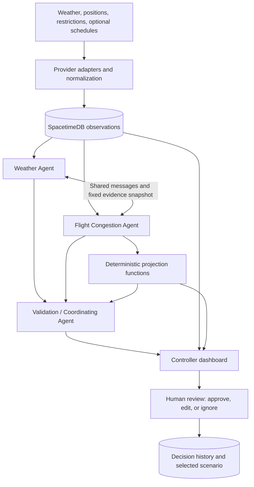

# WatchTower

**Weather-aware airport flow advisories, with people in control.**

WatchTower is a prototype decision-support dashboard for Detroit Metropolitan Wayne County Airport (**DTW / KDTW**). Its planned workflow brings together aviation weather, nearby aircraft positions, published airport restrictions, and—when available—verified flight schedules. Three cooperating agents turn that evidence into concise flow advisories for a simulated tower flow-coordination user to review.

The goal is to help a person answer three questions: **What is changing? Why does it matter? What tradeoffs would a response create?** A controller can inspect the evidence, preview a scenario, and approve, edit, or ignore an advisory. Approval records a human decision and selects a projected scenario for display. The project reads data; it has no connection to aircraft-control or clearance systems.

The architecture and requirements are in [full_technical_plan.md](full_technical_plan.md).

## Why this matters: evidence and potential impact

Airport congestion depends on both demand and the conditions that constrain capacity. The FAA reports that weather accounted for **74.26% of National Airspace System system-impacting delays longer than 15 minutes from June 2017 through May 2023**; traffic volume alone accounted for **14.92%**. These are national statistics for a defined delay category, rather than DTW-specific passenger-delay rates. The FAA also explains that weather has greater delay consequences when airports already operate close to capacity. [Source: FAA, Weather Delay FAQ](https://www.faa.gov/nextgen/programs/weather/faq).

Research and field demonstrations show why coordinated flow support is worth exploring. NASA's **Airspace Technology Demonstration 2 (ATD-2)** integrated arrival, departure, and surface information at Charlotte Douglas International Airport. NASA reported estimated savings during its first four years of **more than one million gallons of fuel**, **5,948 hours of engine runtime**, and **916.4 hours of delay**. Surface metering helped aircraft wait at the gate with engines off instead of joining a runway queue prematurely. [Source: NASA, An Electronic Traffic Monitor for Airports, June 2022](https://spinoff.nasa.gov/Electronic-Traffic-Monitor-for-Airports).

These results establish the value of coordinated airport decision support; **they are not WatchTower results or forecasts for DTW**. WatchTower explores whether a smaller, traceable advisory workflow can make changing conditions and response tradeoffs easier to understand. Its effects on delay, workload, fuel consumption, and emissions have not been measured. Any future benefit claim needs operational evaluation and appropriate data.

## How it helps people

| People | Intended benefit | How WatchTower supports it |
| --- | --- | --- |
| Controllers and flow coordinators | Understand changing conditions and review options with context | A short advisory queue with source timestamps, evidence, ownership, assumptions, and scenario comparisons |
| Passengers | Potentially more predictable journeys and less unnecessary waiting if better coordination translates into operations | Highlight weather/demand mismatches early enough for a human to review; passenger outcomes still require evaluation |
| Airline and airport teams | A shared account of what was proposed and decided | Versioned advisories and decision history tied to the exact evidence snapshot |
| Communities around airports | Potential environmental benefits from more efficient ground operations | Explore queue and waiting tradeoffs; fuel and emissions savings require defensible engine-state and performance inputs |
| Researchers and student teams | A concrete way to study accountable agent cooperation | Separate specialist roles, typed messages, deterministic checks, and isolated TEST scenarios |

Moving waiting from the runway queue to an upstream location does not necessarily reduce total delay. The planned model counts both and shows unfavorable tradeoffs as well as favorable ones.

## The three agents

There are exactly **three application agents**. Data adapters, projection functions, and runtime services are infrastructure. The frontend is a separate human workstream.

| Agent | What it does in the planned workflow | What it returns |
| --- | --- | --- |
| **Weather Agent** | Interprets KDTW METAR observations and TAF forecasts; identifies supported wind, visibility, ceiling, precipitation, and regional hazard changes; distinguishes observations from forecasts and conditional groups | A `WeatherAssessment` with evidence, explicit units, relevant time windows, missing inputs, and assumptions; clear weather is a valid result |
| **Flight Congestion Agent** | Measures nearby traffic pressure; uses verified airport-associated schedules/status for demand windows when available; combines weather and FAA restrictions; proposes a bounded response and invokes deterministic projection functions | A `FlowCandidate`, supported metrics, tradeoffs, and an optional baseline/proposed projection; nearby aircraft are not automatically DTW flights |
| **Validation / Coordinating Agent** | Coordinates cases; checks evidence, freshness, airport/time/snapshot consistency, allowed actions, and projection calculations; requests at most one correction; suppresses duplicates and unsupported claims | A versioned `ValidatedAdvisory` for the responsible demo role, or a rejected/insufficient-data result |

The validator checks consistency and support; it does not certify safety or approve advisories. Only authorized controller reducers may record decisions against a specific unexpired advisory version. Agents exchange shared messages instead of importing one another's implementations.

## How the workflow fits together

The diagram describes the target end-to-end workflow; implementation status is listed below.



Live observations and hypothetical projections remain separate. The default planned comparison covers **15 minutes**, with baseline and proposed branches starting from the same fixed snapshot. Previewing or accepting a scenario never changes provider observations. Times are stored in UTC and displayed in `America/Detroit`; values carry explicit units. Missing or stale input is unknown, never zero demand.

Planned advisory categories cover weather-flow review, departure-release review, downstream restrictions, and traffic-pressure notices. Aircraft separation, tactical clearances, runway selection, and per-aircraft taxi routing are outside the project's scope.

## What works today

| Area | Repository status |
| --- | --- |
| Observation backend | Implemented local SpacetimeDB weather/aircraft ingestion, source health, ingestion permissions, and Python HTTP bridge |
| Dashboard connection | React subscriptions to observation tables, including empty, error, disconnected, and stale-data states; production sessions are read-only |
| Agent coordination | Typed Fetch.ai messages, validation-owned orchestration, and a Bureau builder for exactly three prepared agent identities |
| Interactive demo | Isolated sample-data dashboard with map, advisory review, scenario playback, bounded edits, approvals/dismissals, and history |
| Remaining live workflow | Provider parsers/polling, specialist factories and logic, deterministic projections, domain validation/persistence callbacks, and controller decision backend integration |

The demo's aircraft paths are hand-authored illustrations, and its revalidation uses fixed synthetic series. They do not demonstrate calculated flight routes, live provider coverage, or backend decision authorization. Passing repository checks does not pass the operational release gates. See the remaining checklist in [quality control](docs/quality-control.md).

## Repository map and contribution guide

```text
agents/weather/       Weather implementation and unit tests
agents/congestion/    Congestion implementation and unit tests
agents/validation/    Validation, orchestration, and unit tests
data/                Provider adapters, normalization, and source health
projection/          Deterministic aggregate-flow model helpers
shared/              Contracts, messages, settings, LLM and database interfaces
runtime/             Three-agent Bureau composition and scheduling
backend/module/      TypeScript SpacetimeDB tables, reducers, and permissions
frontend/            React dashboard and generated database bindings
tests/               Contract, integration, decision, and isolated TEST fixtures
docs/                Setup, ownership, interface proposals, and release gates
```

Read [ownership](docs/ownership.md) and [contributing](CONTRIBUTING.md) before changes. Each contributor uses a separate clone/worktree and keeps agent unit tests with that agent. Coordinate shared contracts, lockfiles, configuration, and generated backend bindings; include shared interface proposals in the PR. Never hand-edit generated bindings. Run `make check` before proposing a merge.

## How to use the project

### 1. Install dependencies

Use **Python 3.13** (3.12 is also supported) and **Node.js 24**, matching the repository version files. Run these commands from the repository root:

```sh
python3 -m venv .venv
source .venv/bin/activate
python -m pip install -r requirements-dev.txt
python -m pip install --require-hashes -r requirements-runtime.txt
npm --prefix backend/module ci
npm --prefix frontend ci
make check
```

The unit/build checks require no provider credentials.

### 2. Try the interactive sample-data demo

This is the quickest way to explore the review workflow. It requires no database, agent seeds, or provider credentials.

```sh
npm --prefix frontend run dev:test
```

Open **http://127.0.0.1:5174**. The workspace displays **Demo mode** and uses isolated TEST data. The basemap requires internet access and WebGL; the demo cannot access aircraft/weather providers or a database.

1. Inspect the DTW map, source health, weather, and specialist findings.
2. Select an advisory and review its reason, evidence, expiry, and assumptions.
3. Preview baseline/proposed scenarios and use the 0–15-minute playback controls.
4. Approve to record a TEST decision and select its scenario, or edit bounded parameters and use TEST revalidation before approval. Dismiss an item to exercise the ignore workflow.
5. Open History to inspect the recorded version and decision. Use **Demo settings** in the footer to switch between two TEST identities and rehearse read-only, outage, and reconnect states. Reload to reset the scenarios.

See [frontend documentation](frontend/README.md) for the demo's controls and limitations.

### 3. Run the local observation dashboard

Install/use **SpacetimeDB CLI and server 2.10.2** and verify with `spacetime --version`. Create local environment files only if they do not already exist; preserve existing settings:

```sh
cp -n .env.example .env
cp -n frontend/.env.example frontend/.env
```

Start the server in one terminal from the repository root:

```sh
spacetime start --listen-addr 127.0.0.1:3000
```

In another terminal, also from the repository root:

```sh
spacetime dev --delete-data=never
```

The existing root `spacetime.json` points to the module and frontend. Confirm the publish target is the local server. The dev command publishes the module, regenerates bindings, watches changes, and starts Vite. Open the printed URL, normally **http://localhost:5173**.

Without provider ingestion, expect **Connected / No live observations**. Setup does not seed aircraft or weather. This production entrypoint currently displays observations only; live advisories, projections, and controller decisions remain unavailable. There is no completed live-agent startup command yet.

For ingestion identity provisioning and the eventual live start order, follow [local development](docs/development.md). The Python settings read process environment; a launcher must load/export root `.env`. Initial planned sources are NOAA Aviation Weather Center, ADSB.lol, and FAA NAS Status. Optional FlightAware AeroAPI requires a key and an explicit budget before enabling it. Departure-demand projections require verified airport-associated flight records; nearby positions alone do not establish a departure queue.

Keep tokens, provider keys, and separate agent seeds in ignored backend settings. The browser permits only `VITE_SPACETIMEDB_WS_URL`, `VITE_SPACETIMEDB_DATABASE`, and `VITE_DISPLAY_TIMEZONE` from [frontend/.env.example](frontend/.env.example). Controller session credentials must not enter browser environment variables.

### 4. Verify changes

```sh
source .venv/bin/activate
make check
make check-spacetime
```

`make check` runs repository policy, Python tests/lint/types, backend checks, frontend tests, and the production build. `make check-spacetime` requires the pinned local CLI/server and creates an isolated TEST database to verify the observation foundation, authorization, concurrent updates, two SDK clients, and generated-binding consistency. Neither proves the remaining live advisory release gates. CI additionally scans commit history with Gitleaks; see [GitHub enforcement](docs/github-settings.md).

## Tech stack

| Technology | Role |
| --- | --- |
| **Python 3.13 / 3.12** | Agent code, provider integration, shared contracts, and deterministic calculation infrastructure |
| **Fetch.ai uAgents 0.26.0** | Typed agent messages, signed protocols, and local Bureau composition for three identities |
| **SpacetimeDB 2.10.2** | TypeScript database module, transactional reducers, shared state, and real-time subscriptions; Python uses a small HTTP adapter |
| **React 19 + TypeScript + Vite 7** | Dashboard, advisory review, comparison views, and history |
| **MapLibre GL JS 6.12.0 + OpenFreeMap** | Geographic DTW map, with provider attribution |
| **ASI:One / interchangeable LLM interface** | Planned supported-weather interpretation and concise advisory wording; calculations and constraints stay in code |
| **NOAA AWC, ADSB.lol, FAA NAS Status** | Planned initial weather, nearby-position, and published-restriction sources |
| **FlightAware AeroAPI; optional NWS/OpenSky** | Additional planned schedule/status, regional weather, or position coverage, subject to configuration and release gates |
| **unittest, Ruff, mypy, Vitest, Testing Library, ESLint, Prettier, Gitleaks** | Regression tests, types, formatting, repository policies, and secret scanning |

Dependency versions are pinned or resolved in the Python requirements and the backend/frontend npm lockfiles. Implementation details live in the [technical plan](full_technical_plan.md), [shared interfaces](docs/interfaces.md), and [orchestration guide](docs/orchestration.md).
