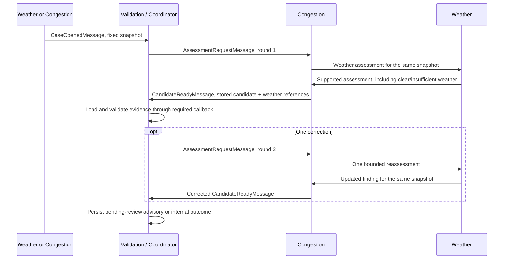

# Fetch.ai orchestration

The existing Validation / Coordinating Agent owns orchestration. Exactly three
uAgent identities remain: weather, congestion, validation. No extra seed, token,
LLM router, or fourth workstream is introduced.

The [Fetch.ai quickstarter](https://github.com/fetchai/innovation-lab-examples/tree/main/fetch-hackathon-quickstarter)
uses an orchestrator as a chat router for two helper agents. That is an example
architecture, not a requirement to create a fourth identity. Our validation
role supplies the coordination entry point; [Bureau](https://uagents.fetch.ai/docs/guides/bureau)
runs the three prepared identities together.

## Components and ownership

- agents/validation/orchestrator.py: bounded in-memory case lifecycle and routing.
- agents/validation/protocol.py: signed SDK handlers, transport, validation and
  idempotent outcome-persistence callbacks.
- shared/orchestration.py: immutable reference packets and phase/verdict enums.
- shared/messages.py: uAgents wire models and validated domain-envelope conversion.
- runtime/bureau.py: bare and coordinated three-agent Bureau assembly.

Validation/integration owns the coordinator and runtime. All affected agent owners
review wire-contract changes. uAgents 0.26.0 is pinned in pyproject.toml; its
dependencies and distribution hashes are in requirements-runtime.txt. The SDK
uses Pydantic v1 internally, so a wire envelope explicitly converts to the
existing slotted dataclass rather than handing that dataclass directly to Model.

## Workflow



Opening may come only from a configured specialist address. Congestion owns the
weather exchange and combined candidate. A candidate must name its stored weather
assessment and reply to the current round's request ID/correlation ID. The
coordinator does not treat these references as verified facts: the domain callback
must retrieve and check the actual packet, including projection/action rules.

Duplicate openings for the same case/snapshot do not redispatch. Duplicate
candidate messages do not revalidate. Changed retry payloads, wrong senders,
snapshot/evidence changes, outdated rounds and stale results are rejected.
One correction is allowed, with the original deadline preserved. Timeouts,
transport failure and validator failure close to internal insufficient-data state.

## Wiring when the agent implementations exist

Construct the three agent factories with separate local secrets. Implement these
two async callbacks before invoking the coordinated builder:

```python
from runtime.bureau import build_coordinated_bureau
from shared.contracts import AgentName

# weather, congestion, validation are prepared uAgents from their owned factories.
# validate_candidate loads stored evidence and returns a ValidationVerdict.
# persist_outcome is idempotent and writes through authorized backend reducers.
bureau = build_coordinated_bureau(
    {
        AgentName.WEATHER: weather,
        AgentName.CONGESTION: congestion,
        AgentName.VALIDATION: validation,
    },
    validate=validate_candidate,
    persist=persist_outcome,
)
bureau.run()
```

This is integration guidance, not a runnable live command: specialist factories,
weather/traffic analyses, domain validation and database reducers are still
pending. No default callback claims that evidence passed.

On a case trigger, a specialist sends CaseOpenedMessage to validation. Congestion
handles AssessmentRequestMessage, obtains the weather finding, stores its combined
candidate and sends CandidateReadyMessage to validation. Preserve the requested
snapshot/evidence IDs, assessment_round and correlation_id; set reply_to to the
current assessment request's message_id and sender_agent to congestion.

register_orchestration() can also attach the same protocol to an existing
validation agent before a distributed deployment. SDK handlers require verified
messages and then apply an explicit sender-address allowlist. Do not use the
quickstarter's public chat input as authorization to open operational cases.

## Persistence, expiry and current limits

Case state is bounded to 256 retained cases, with a 60-second default workflow
deadline capped by the opening envelope's validity. These are prototype settings.
No overlapping validation for the same case is started; a new material snapshot
needs a new case/version. Issue/resource/window deduplication remains an upstream
implementation task.

Terminal notifications remain queued after failed persistence and retry on the
interval handler. Persistence has a five-second timeout and must be idempotent by
case/round/version. A queued, unpersisted publish result becomes insufficient-data
when its candidate/deadline expires. The backend callback must enforce freshness
and version atomically at write time as well.

READY_TO_PUBLISH means publish a pending-review advisory, never approve or execute
it. Controllers retain all decision authority. The coordinator has no observation
or controller-decision write path.

Memory-state idempotency is process-local: restart recovery and cross-process
deduplication require SpacetimeDB persistence and its reducer checks. Do not claim
exactly-once publication from this in-memory service. Pruning waits for successful
outcome persistence and the original opening's expiry.

Tests cover the coordinator, SDK JSON serialization, signed protocol registration,
three-identity Bureau composition and mocked transport/callback failures.
Ledger services are mocked in SDK construction tests; no server or live provider
is started. Real specialist messaging, live sources, database persistence and
controller races remain separate acceptance gates.
